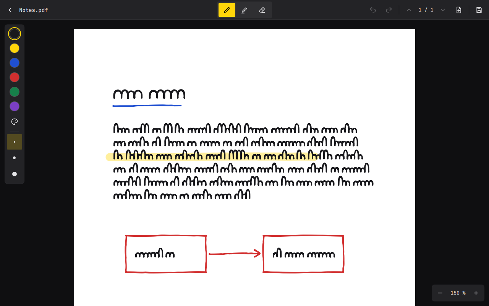
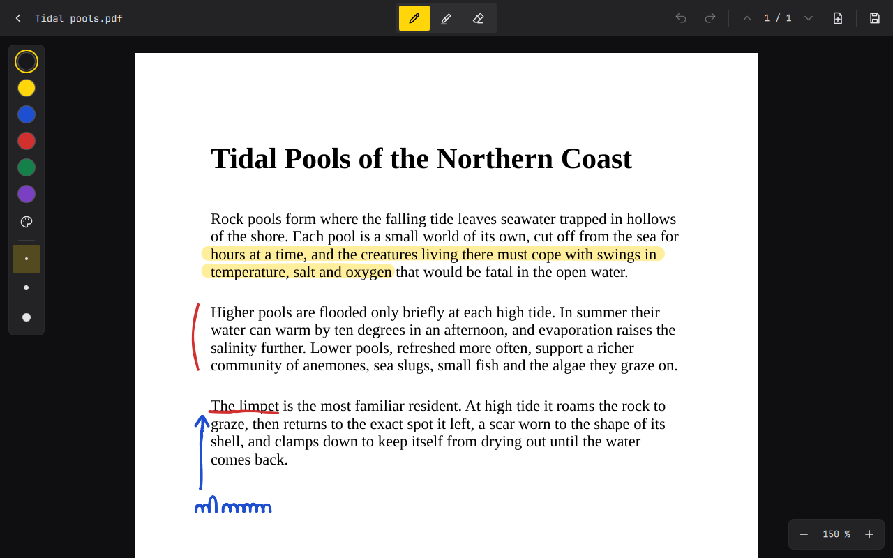

# Omanote

Handwritten notes and PDF annotation for [Omarchy](https://omarchy.org), built for
2-in-1 touchscreens with a pen and just as quick with a mouse and keyboard.



## Features

- **Endless notebooks.** Fresh paper appears as you write or scroll past the
  end. Blank sheets you scroll away from disappear, and empty paper before or
  after your writing is never saved.
- **Annotate any PDF without altering it.** Ink goes on its own layer; the
  original text, vectors and links stay untouched and selectable.
- **Re-edit anytime.** Strokes are stored inside the PDF, so a reopened file
  brings every stroke back as erasable ink, and re-saving never stacks
  duplicate copies. Other PDF viewers show the ink as ordinary vector graphics.
- **Pen first.** Pressure-sensitive pen, a highlighter that keeps text
  readable, a whole-stroke eraser on the pen's eraser end or barrel button,
  palm rejection, one-finger scroll, two-finger pinch zoom, and momentum
  scrolling on touch, touchpad and pen.
- **At home on Omarchy.** Follows the theme, window rounding and language
  live, and uses the desktop's own file dialogs. Elsewhere on Arch it runs
  with a dark look and Omarchy's yellow.
- **Light on resources.** GPU-tiled pages, constant-cost live ink, PDFs read
  from disk rather than held in memory, and no background work when idle.



## Install

On Omarchy or Arch Linux, until Omanote is in Omarchy's package repository,
build and install it from source:

```sh
git clone https://github.com/sam-f-gh/omanote
cd omanote
bin/install    # builds, tests and installs the package; Omanote appears in the launcher
```

`bin/install` pulls in what it needs: `qt6-base qt6-declarative poppler-qt6
qpdf xdg-desktop-portal` to run, `wayland-protocols` to build, and a font for
the tests. Open and save dialogs come from the desktop's portal; Omarchy, GNOME
and KDE have one, and on a desktop without a file chooser (sway, i3) install
`xdg-desktop-portal-gtk`.

Open a file directly with `omanote file.pdf`.

## Usage

| Keys | Action |
|---|---|
| `P` `H` `E` | Pen, highlighter, eraser |
| `Ctrl+Z`, `Ctrl+Shift+Z` or `Ctrl+Y` | Undo, redo |
| `Ctrl+S`, `Ctrl+Shift+S` | Save in place, save as |
| `Ctrl+N`, `Ctrl+O` | New note, open PDF |
| `PageDown` or `N`, `PageUp` or `B` | Next, previous page |
| `+` | Insert a blank page |
| `Ctrl+Wheel` or `Ctrl+±`, `Ctrl+0` | Zoom, fit width |
| `Esc`, `Q` | Close document, quit |
| `?` | All shortcuts |

The pen writes, and its eraser end or barrel button erases; in the margins it
scrolls. Fingers only scroll and zoom, and are ignored while the pen is near
the screen. A mouse draws with the left button and pans with the middle one.

## Development

```sh
bin/build      # build/omanote
bin/test       # tests, run offscreen
omarchy agent look app -- ./build/omanote file.pdf    # screenshot it offscreen
```

C++20 and Qt 6 Quick, built with `qmake6`. Rendering uses poppler; reading and
writing PDFs uses qpdf. The version lives in `omanote.pro`; bump it before
tagging a release. CI builds and tests every push on Arch.

| Source | Role |
|---|---|
| `src/ink` | Stroke geometry, one outline shared by screen and PDF |
| `src/document` | Pages, undo history, save snapshots |
| `src/pdfstore` | Loading, ink-layer stripping and atomic saves via qpdf |
| `src/tilerenderer` | Worker threads that render page tiles |
| `src/noteview` | GPU canvas, live ink and input handling |
| `src/theme`, `src/translator` | Following Omarchy's theme, rounding and language |
| `src/portalfilepicker` | Open and save dialogs through xdg-desktop-portal |
| `src/*.qml` | Interface |

## License

[MIT](LICENSE)
