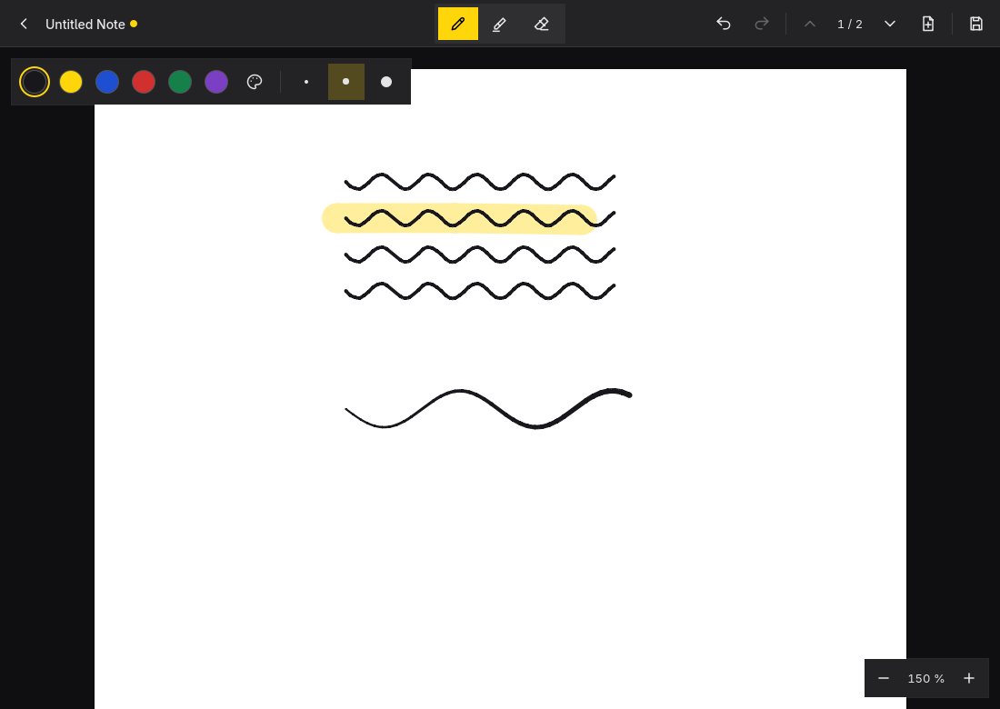

# Omanote



Minimalist handwritten notes and PDF annotation for Omarchy, built for 2-in-1
touchscreens with a pen and just as fast with mouse and keyboard.

- **New Note** — endless white paper. Write on the last page and a fresh one
  appears below. Saving keeps the first through the last page with ink.
- **Open PDF** — write over any PDF without flattening it: text stays
  selectable, vectors stay vectors. `Ctrl+S` saves in place; `Ctrl+Shift+S`
  saves a copy.
- **Re-edit forever** — ink is saved twice: as a vector layer ("Omanote Ink")
  any viewer shows, and as stroke data Omanote reads back, so old strokes stay
  erasable and re-saving never stacks ghost copies.

Pressure-sensitive pen, multiply highlighter, whole-stroke eraser (pen's
eraser end or barrel button too), palm rejection, one-finger scroll,
two-finger pinch zoom. Follows the Omarchy theme, Hyprland rounding and
language live.

## Shortcuts

| Keys | Action |
|---|---|
| `P` / `H` / `E` | Pen / Highlighter / Eraser |
| `Ctrl+Z` | Undo |
| `Ctrl+Shift+Z` / `Ctrl+Y` | Redo |
| `Ctrl+S` | Save (asks where only for a never-saved note) |
| `Ctrl+Shift+S` | Save As |
| `Ctrl+O` / `Ctrl+N` | Open PDF / New Note |
| `PageDown` / `N`, `PageUp` / `B` | Next / previous page |
| `+` / `=` | Add blank page after the current one |
| `Ctrl+Wheel`, `Ctrl++` / `Ctrl+-`, `Ctrl+0` | Zoom, fit width |
| `Esc` | Close document |
| `?` | Shortcuts overlay |
| `Q` / `Ctrl+Q` | Quit |

## Input

| Input | On a page | In the margins |
|---|---|---|
| Pen tip | Draws or erases | Scrolls |
| Pen eraser end / barrel button | Erases (even mid-stroke) | Scrolls |
| One finger | Scrolls | Scrolls |
| Two fingers | Pinch zoom + pan | Same |
| Mouse | Left draws, middle pans, wheel scrolls | Left or middle pans |

Touches are ignored while the pen is near or down, and for 200 ms after.

## Build

Needs `qt6-base qt6-declarative qt6-svg poppler-qt6 qpdf`.

```sh
bin/build                 # build/omanote
build/omanote file.pdf    # open a PDF directly
bin/test                  # tests, offscreen
bin/install               # makepkg -fsi, adds it to the launcher
```

## Layout

`src/ink` stroke geometry (one outline for screen and PDF), `src/document`
pages and undo, `src/pdfstore` qpdf load/strip/save, `src/viewport` pan and
zoom math, `src/pagerenderer` async poppler, `src/noteview` the canvas and
input, `src/backend` open/save flows, QML for the chrome.
